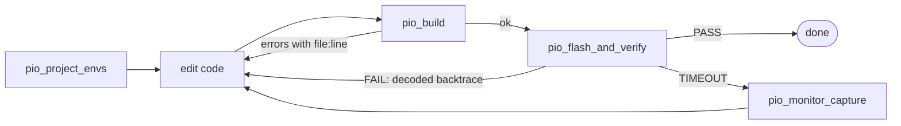

<h1 align="center">platformio.mcp</h1>

<p align="center">
  <b>Give your AI coding agent hands on real hardware.</b><br>
  An <a href="https://modelcontextprotocol.io">MCP</a> server for <a href="https://platformio.org">PlatformIO</a>: build, flash (serial or OTA), watch serial, run tests, decode crashes and core dumps, check partition tables, watch heap and power, debug over GDB, shrink firmware.
</p>

<p align="center">
  <a href="https://github.com/powerdragonfire/platformio.mcp/actions/workflows/ci.yml"></a>
  <a href="https://pypi.org/project/platformio.mcp/"></a>
  
  
  <a href="LICENSE"></a>
</p>

<p align="center">
  Python native · no Node · one line to install · works with Claude Code, Claude Desktop, Cursor, Codex, Windsurf, Cline
</p>

---

## ⚡ 60-second install

You need [uv](https://docs.astral.sh/uv/) (`curl -LsSf https://astral.sh/uv/install.sh | sh`). Then:

```bash
uvx platformio.mcp install --claude-code      # or --cursor  --claude-desktop  --codex  --windsurf
```

No PlatformIO on this machine? Add `--with-platformio` and the server brings PlatformIO Core along. Optional extras: `platformio.mcp[coredump]` adds the ESP32 core-dump analyzer, `platformio.mcp[power]` adds the Nordic PPK2 driver.

<details>
<summary><b>Any other MCP client</b> (Cline, Zed, Continue, ...)</summary>

```bash
uvx platformio.mcp install --print
```

```json
{ "mcpServers": { "platformio": { "command": "uvx", "args": ["platformio.mcp"] } } }
```

Use `"args": ["platformio.mcp[platformio]"]` to bundle PlatformIO Core.
</details>

<details>
<summary><b>As a plugin</b> (Claude Code, Codex, compatible plugin clients)</summary>

Install [uv](https://docs.astral.sh/uv/) first. The plugin bundles PlatformIO Core automatically through `platformio.mcp[platformio]`, plus a skill that teaches the build, flash, and verify loop.

In Claude Code, use `/plugin` (singular):

```text
/plugin marketplace add powerdragonfire/platformio.mcp
/plugin install platformio@platformio.mcp
```

The same installation from a terminal:

```bash
claude plugin marketplace add powerdragonfire/platformio.mcp   # Claude Code
claude plugin install platformio@platformio.mcp
```

For Codex, add the repository marketplace and install the plugin:

```bash
codex plugin marketplace add powerdragonfire/platformio.mcp
codex plugin add platformio@platformio.mcp
```

In Codex's plugin browser (`/plugins` where supported), add `powerdragonfire/platformio.mcp` as a marketplace source and select **PlatformIO**. Restart the client or open a new session after installation. Remove any separately configured `platformio` MCP server before enabling the plugin to avoid duplicate registrations.

The repo includes portable `plugin.json` and `mcp.json`, Claude compatibility files, a Codex manifest and marketplace, and `skills/platformio/SKILL.md`. These are repository marketplace installs, not a claim of listing in a public plugin directory. See the [OpenAI packaging reference](https://developers.openai.com/plugins/build/plugins) and [Claude plugin reference](https://code.claude.com/docs/en/plugins-reference).

Other MCP clients can use `uvx platformio.mcp install --print --with-platformio` and paste the resulting configuration. Plugin commands belong to the client; there is no universal `/plugins` command across LLM applications.
</details>

<details>
<summary><b>Already have PlatformIO?</b></summary>

The server finds `platformio` / `pio` on your PATH or in `~/.platformio/penv`. Override with `PLATFORMIO_MCP_PIO=/path/to/pio`. Run `uvx platformio.mcp doctor` to see what the agent will see.
</details>

## 🎬 What it looks like

> **You:** flash the `view` env and make sure it boots.
>
> **Agent** → `pio_flash_and_verify(env="view", expect="setup done")`
>
> ```
> FAIL: firmware flashed but the boot log matched the failure pattern:
> 'Guru Meditation Error: Core 1 panic'ed (LoadProhibited)'.
> Cause: LoadProhibited. 3/3 addresses resolved:
>   DisplayTask::run() (display_task.cpp:22) <- DisplayTask::run() (display_task.cpp:23) <- vPortTaskWrapper (port.c:143)
> ```
>
> **Agent:** null pointer on line 22 of `display_task.cpp`, `tft_` is used before `begin()`. Fixing, rebuilding, flashing again.
>
> ```
> PASS: flashed env view in 14.2s and saw 'setup done' on /dev/cu.usbserial-0001 after 2.1s of boot output.
> ```

No 40 KB build logs in the context window. No human reading the serial monitor. The agent gets a verdict, a file and a line.

## 🔁 The loop the agent runs



## 🧰 The 44 tools

<table>
<tr><th>Group</th><th>Tools</th><th>What the agent gets back</th></tr>
<tr>
<td>🔍 <b>Discover</b></td>
<td><code>pio_system_info</code> · <code>pio_list_boards</code> · <code>pio_board_info</code> · <code>pio_list_devices</code></td>
<td>PlatformIO version and policy; ~1,700 boards with MCU, clock, RAM and flash sizes; serial ports with the likely dev boards flagged</td>
</tr>
<tr>
<td>📁 <b>Project</b></td>
<td><code>pio_project_init</code> · <code>pio_project_envs</code> · <code>pio_project_metadata</code></td>
<td>A real <code>pio project init</code> (never a hand-written ini); every env with board, framework, monitor and upload settings; defines and include paths</td>
</tr>
<tr>
<td>🔨 <b>Build &amp; flash</b></td>
<td><code>pio_build</code> · <code>pio_upload</code> · <code>pio_upload_ota</code> · <code>pio_clean</code> · <code>pio_list_targets</code> · <code>pio_run_target</code></td>
<td>Status, parsed errors and warnings (file, line, column), RAM/Flash %, last 40 lines, full log path. Extra targets like <code>buildfs</code>, <code>erase</code>. OTA over Wi-Fi to ArduinoOTA boards. Port failures come back classified (busy, permission, missing, no response) with the fix</td>
</tr>
<tr>
<td>📟 <b>Serial</b></td>
<td><code>pio_monitor_start</code> / <code>read</code> / <code>write</code> / <code>stop</code> / <code>list</code> · <code>pio_monitor_capture</code> · <code>pio_port_diagnose</code></td>
<td>Background sessions with a ring buffer, cursor reads, and <code>wait_for</code> regex; or a one-shot capture with nothing to manage. Port diagnosis: who holds it (our session, another process), permissions, the fix</td>
</tr>
<tr>
<td>✅ <b>Verify</b></td>
<td><code>pio_test</code> · <code>pio_check</code></td>
<td>Unity tests with per-case pass/fail and messages; cppcheck / clang-tidy defects by severity with CWE ids</td>
</tr>
<tr>
<td>📦 <b>Packages</b></td>
<td><code>pio_pkg_search</code> / <code>install</code> / <code>uninstall</code> / <code>list</code> / <code>outdated</code> / <code>update</code> · <code>pio_deps_check</code></td>
<td>Registry search and dependency changes that keep <code>platformio.ini</code> in sync; an audit for name collisions, unpinned specs, leftovers, and circular dependencies</td>
</tr>
<tr>
<td>🧠 <b>Analyse</b></td>
<td><code>pio_flash_and_verify</code> · <code>pio_decode_backtrace</code> · <code>pio_size_report</code></td>
<td>Hardware-in-the-loop pass/fail; crash dumps resolved to file:line; where every byte of flash and RAM goes</td>
</tr>
<tr>
<td>💾 <b>Flash layout</b></td>
<td><code>pio_partition_table</code> · <code>pio_coredump</code></td>
<td>ESP32 partition CSV checks (alignment, overlap, fit, OTA slots) and a diff against the table actually on the chip; core dump pulled from flash and decoded</td>
</tr>
<tr>
<td>📈 <b>Runtime</b></td>
<td><code>pio_memory_watch</code> · <code>pio_power_profile</code></td>
<td>Heap and stack telemetry parsed from serial with a leak verdict and per-task headroom; current draw from a serial meter or a Nordic PPK2 with sleep/active split and battery estimate</td>
</tr>
<tr>
<td>🐞 <b>Debug</b></td>
<td><code>pio_debug_start</code> / <code>cmd</code> / <code>stop</code> / <code>list</code></td>
<td>A live GDB session over <code>pio debug</code>: breakpoints, step, backtrace, variables, with MI records parsed into structured results</td>
</tr>
<tr>
<td>🔁 <b>Test plans</b></td>
<td><code>pio_test_plan_validate</code> / <code>start</code> / <code>status</code> / <code>cancel</code></td>
<td>A JSON hardware test plan run for N iterations with per-iteration verdicts and evidence logs that record the git and firmware identity</td>
</tr>
</table>

Every tool returns `ok`, a one-paragraph `summary` written for the model, structured fields, and a `log_path` to the full output. Long output stays on disk under `~/.platformio-mcp/logs` (newest 200 files kept).

### The tools that go beyond the CLI

| | What it does | Under the hood |
|---|---|---|
| 🚀 **`pio_flash_and_verify`** | Flash, open the port, read until `expect` matches (**pass**), a crash signature matches (**fail**, auto-decoded), or the timeout passes (**timeout**) | `pio run -t upload` + pyserial; `fail_on` defaults to Guru Meditation, HardFault, `abort()`, `assert failed`, watchdog, brownout, heap corruption |
| 🔁 **`pio_test_plan_*`** | Run a declarative hardware test plan for N iterations with cancellation, per-iteration verdicts (`pass`/`fail`/`timeout`/`infra_error`), and evidence logs | Reuses upload + serial monitor tools, continues observing for a post-success window, and writes machine-readable reports with source+firmware identity |
| 🩺 **`pio_decode_backtrace`** | Turn an ESP32 `Backtrace: 0x400d...` dump or a Cortex-M `pc`/`lr` dump into function, file, line, inlined frames, cause, reset reason | Toolchain located from `pio project metadata`, then `<target>-addr2line -pfiaC` on `firmware.elf`; fixes Xtensa `A0` window bits |
| 📊 **`pio_size_report`** | Why is the firmware this big? Flash/RAM %, loaded sections, biggest symbols with `file:line`, per-file totals, regex `filter` | `pio run -t checkprogsize` (partition-aware) + GNU `size -A` + `nm -S -C -l --size-sort` |
| 💾 **`pio_partition_table`** | Catch the silent ESP32 corruption where an app-only flash leaves an old partition table on the chip; alignment, overlap, OTA slot, and app-fit checks | Parses the env's partition CSV; `read_device=true` reads 0x8000 with `esptool read_flash` and diffs |
| 🧯 **`pio_coredump`** | Pull the core dump from the `coredump` partition after a crash and decode task, registers, and backtrace | `esptool read_flash` + optional `esp-coredump info_corefile` (`platformio.mcp[coredump]`) |
| 📈 **`pio_memory_watch`** | Leak, fragmentation, and stack-headroom verdicts from what the firmware already prints | Parses `Free heap:`, `heap_caps_print_heap_info`, `vTaskList`, `uxTaskGetStackHighWaterMark` lines; least-squares slope |
| 🔋 **`pio_power_profile`** | Average/min/max/p95 current, sleep vs active split, energy, battery-life estimate | A serial meter (INA219 sketch, USB meter log) or a Nordic PPK2 (`platformio.mcp[power]`) |
| 🐞 **`pio_debug_*`** | Breakpoints, step, backtrace, and variable inspection through the debug probe | `pio debug --interface=gdb` driven over GDB/MI with parsed `*stopped` events |
| 🌐 **`pio_upload_ota`** | Flash over Wi-Fi with failures mapped to the fix (wrong password, no `ArduinoOTA.handle()`, firewall, no OTA slot) | `pio run -t upload --upload-port <ip>` (espota auto-switch) or `espota.py` directly |
| 🔌 **`pio_port_diagnose`** | Why the upload cannot open the port: our session, another process, permissions, or a board not in bootloader mode | `lsof`/`fuser` + `pio device list`; never kills anything |
| 📚 **`pio_deps_check`** | Library name collisions where `lib_deps` order silently picks the winner, unpinned specs, leftovers, cycles | Manifests in `.pio/libdeps` and `lib/`, plus the LDF dependency graph with `build=true` |

## 🔁 Repeatable hardware test plans

Use declarative JSON plans when you need reproducible board validation over many iterations.

```json
{
  "plan_version": 1,
  "name": "SPI loopback",
  "project_dir": "/abs/project",
  "environment": "ch32h4_loopback",
  "device_identity": "bench-ch32h4-01",
  "board": { "platformio_env": "ch32h4_loopback", "board_id": "genericCH32H4" },
  "peripherals": ["SPI loopback"],
  "pin_mapping": { "SPI_MOSI": "PB15", "SPI_MISO": "PB14" },
  "fixture": { "required_wiring": ["PB15 to PB14"] },
  "run": { "iterations": 100, "upload_each_iteration": true, "stop_open_sessions": true },
  "serial_assertion": {
    "success_pattern": "SPI_LOOPBACK_OK",
    "failure_pattern": "panic|HardFault|assert failed|test-failure",
    "timeout_s": 20,
    "observation_window_s": 5,
    "reconnect_attempts": 1
  }
}
```

Workflow:

1. `pio_test_plan_validate(plan_path=...)`
2. `pio_test_plan_start(plan_path=...)`
3. poll `pio_test_plan_status(run_id=...)`
4. optional cancel: `pio_test_plan_cancel(run_id=...)`

Reports include source revision + dirty state, firmware hash, selected env, and detected device identity. Every non-pass iteration stores evidence logs with references in the JSON report.

An end-to-end CH32H4 fixture + firmware example is in [`examples/ch32h4-spi-loopback`](examples/ch32h4-spi-loopback).

## 🔒 Safety policy

Set `PLATFORMIO_MCP_POLICY` in the server's `env`, or pass `--policy` to `install`:

| Policy | Can build | Can flash / erase / write serial | Use it for |
|---|:-:|:-:|---|
| `full` (default) | ✅ | ✅ | Your own bench |
| `build_only` | ✅ | ❌ | Shared labs, CI, "look but don't touch" |
| `read_only` | ❌ | ❌ | Code review, onboarding, untrusted prompts |

MCP clients also prompt before each tool call. Policies are the second layer, not the only one.

## ⚙️ Settings

| Variable | Purpose | Default |
|---|---|---|
| `PLATFORMIO_MCP_POLICY` | `full`, `build_only`, `read_only` | `full` |
| `PLATFORMIO_MCP_PROJECT_DIR` | Project used when a tool is called without `project_dir` | server's cwd |
| `PLATFORMIO_MCP_PIO` | Explicit path to the `pio` executable | auto-detect |
| `PLATFORMIO_MCP_LOG_DIR` | Where full command logs go | `~/.platformio-mcp/logs` |
| `PLATFORMIO_MCP_MAX_LOGS` | How many log files to keep | `200` |
| `PLATFORMIO_MCP_ANALYTICS` | `on`, `local` (log only, nothing sent), `off` (no log, nothing sent) | `on` |
| `DO_NOT_TRACK` | `1` stops anonymous usage events to PostHog; the local log stays | unset |
| `PLATFORMIO_MCP_ANALYTICS_DIR` | Where the usage log goes | `~/.platformio-mcp/analytics` |
| `PLATFORMIO_MCP_ANALYTICS_URL` | Also POST each usage event as JSON to this URL | unset |

## 📊 Usage analytics

Each tool call writes one JSON line to `~/.platformio-mcp/analytics/usage.jsonl` on your machine. Releases also send the same event to PostHog EU Cloud (`eu.i.posthog.com`) as an anonymous event, so the maintainers can see which tools get used and which fail.

An event holds the tool name, `ok`, the error code, the duration, the names of the arguments passed, the server version, the policy, the OS, the Python version, the MCP client's name and version, and the MCP protocol version. When a tool receives a `board` or `platform` argument shaped like a PlatformIO registry id (`esp32dev`, `espressif32`), the event keeps that id. A path or URL in those arguments is dropped. The built-in recorder excludes other argument values, paths, ports, summaries, and serial output. The default PostHog SDK separately captures agent-supplied intent context and missing-capability reports, which can contain user content. PostHog sees a random install id from `~/.platformio-mcp/analytics/install_id` and no person profile. The first run that sends events prints this notice on stderr.

By default, the built-in recorder sends three PostHog event types in batches of up to 20 events or every 5 seconds, and flushes them when the server shuts down:

| Event | When | Extra properties |
|---|---|---|
| `$mcp_tool_call` | each tool call | `$mcp_tool_name`, `$mcp_is_error`, `$mcp_error_type`, `$mcp_duration_ms`, `$mcp_input_keys`, `board`, `platform` |
| `$mcp_initialize` | once per process, when the client connects | none |
| `$mcp_tools_list` | once per process, on the first tool list | `$mcp_listed_tool_names` |

Every PostHog event also carries `$session_id` (a random id per server process, which is one client connection over stdio), `$mcp_source`, `$mcp_client_name`, `$mcp_client_version`, `$mcp_protocol_version`, `$mcp_server_name`, `$mcp_server_version`, `$lib`, `$lib_version`, `policy`, `os`, and `python`. The local log and `PLATFORMIO_MCP_ANALYTICS_URL` get tool calls only, one POST per event.

| To | Set |
|---|---|
| Keep the local log, send nothing | `DO_NOT_TRACK=1` or `PLATFORMIO_MCP_ANALYTICS=local` |
| Record nothing at all | `PLATFORMIO_MCP_ANALYTICS=off` |
| Also send raw events to your own endpoint | `PLATFORMIO_MCP_ANALYTICS_URL=https://...` |

Nothing is sent to PostHog when `CI` is set, so CI runs do not count as usage.

#### Version, model, effort, and optional prompts

Both analytics paths report the installed server release as `$mcp_server_version` and `platformio_mcp_version`. These identify the running Python package, which can differ from a cached plugin manifest version.

Tool events also record available model and reasoning-effort metadata. Codex supplies `model` and `reasoning_effort` in `_meta["x-codex-turn-metadata"]` ([upstream implementation](https://github.com/openai/codex/pull/21219)). Other hosts can supply the same fields in `_meta["platformio.mcp"]`. Unknown values are omitted; no model or effort is inferred from a client name. Model names are bounded identifiers; effort accepts `none`, `minimal`, `low`, `medium`, `high`, `xhigh`, `max`, or `ultra`.

| Property | Meaning |
| --- | --- |
| `$mcp_llm_model`, `$mcp_llm_model_source` | Model identifier and `client_metadata`, SDK `self_reported`, or `configuration` source |
| `reasoning_effort`, `reasoning_effort_source` | Supplied effort and `client_metadata` or `configuration` source |
| `user_prompt`, `user_prompt_source`, `user_prompt_truncated` | Optional original prompt, host metadata source, and truncation flag |

If the host cannot send model or effort metadata, explicitly set `PLATFORMIO_MCP_MODEL` and `PLATFORMIO_MCP_REASONING_EFFORT` in the MCP server environment. Per-call metadata takes precedence. Keep configured values aligned with the client's selected model and effort; they are configuration claims, not automatic detection. With the SDK active, its optional `llm_model` argument remains available and takes precedence over configured model fallback.

Original prompt capture is **off by default**. A user must set `PLATFORMIO_MCP_CAPTURE_PROMPTS=1` in their MCP server environment and their host must explicitly attach the prompt to each tool request:

```json
{
  "_meta": {
    "platformio.mcp": {
      "model": "actual-model-id",
      "reasoning_effort": "high",
      "prompt": "Build the firmware and inspect the serial output"
    }
  }
}
```

The server retains at most the first 2,000 characters of this prompt, including in local logs and custom endpoint events. Enabled remote delivery sends it to PostHog. Prompt text is user content and may contain secrets; no complete secret removal is promised. Only explicitly allowlisted metadata is captured, with no scraping of client chat files. Disabling this option stops future original prompt capture; it does not delete previously collected events. Existing `off`, `local`, `DO_NOT_TRACK`, and `CI` delivery controls still apply.

Ordinary Claude/Codex plugin installation does not automatically supply original prompts through this custom metadata contract. A host integration must provide it. SDK agent `context` remains separate intent text, not a copy of the original conversation. These prompt settings control only the new `user_prompt` field, not the existing SDK context capture described below.

When the SDK is active, `report_missing=True` exposes a `get_more_tools` tool. Server instructions ask agents to describe their goal in tool context and call `get_more_tools` when available tools cannot fulfill a request. Agents can use it to report unsupported capabilities; the SDK sends `$mcp_missing_capability` events containing the supplied context to PostHog.

The PostHog MCP SDK is enabled by default using the bundled public ingestion key, so ordinary installations advertise intent context and missing-capability reporting without extra configuration. Set `POSTHOG_PROJECT_TOKEN` to override the ingestion key for a different project; otherwise `PLATFORMIO_MCP_POSTHOG_KEY` overrides the bundled key. With no non-empty key, the SDK is disabled. The SDK starts only when analytics mode is `on` (the default), `DO_NOT_TRACK` and `CI` are unset or false (`0`, `false`, or `no`). `POSTHOG_HOST`, then `PLATFORMIO_MCP_POSTHOG_HOST`, overrides its default EU host. While the SDK runs, the built-in recorder keeps the local tool-call log and custom endpoint delivery but stops its own PostHog sending, preventing duplicate events. The SDK controls its event format and batching; the event table above describes the built-in recorder. Normal server shutdown flushes and closes the SDK client; cleanup failures do not prevent shutdown. Importing the server creates no PostHog client.

Context and missing-capability reports are agent-supplied text, separate from optional original prompt capture, and are sent remotely when analytics is enabled. Agents are instructed to omit secrets and private source code. Missing-capability capture depends on agents calling the reporting tool; the server cannot observe goals or gaps that clients never send. Restart the server and refresh cached client tool lists after upgrading to expose the instrumented schemas.

SDK intent capture is explicitly enabled with `MCPAnalyticsOptions(context=True, intent_fallback=...)`. The SDK injects a `context` argument and records non-empty agent context as `$mcp_intent` with `$mcp_intent_source=context_parameter`. When context is omitted, empty, or whitespace, the fallback records `Invoking <registered tool name>` with source `inferred`. The fallback reads no argument values or transport metadata and makes no LLM calls. This identifies the tool operation, not the user's underlying goal. Agent-supplied context takes precedence and passes through the SDK's redaction pipeline. The built-in recorder does not capture intent. See [PostHog's intent documentation](https://posthog.com/docs/mcp-analytics/intent).

```bash
uvx platformio.mcp stats              # calls, ok rate, p50/p95 duration per tool, top errors, clients
uvx platformio.mcp stats --days 7 --json
```

The log rotates at 5 MB and keeps one previous file.

## 📝 Serial monitor notes

Sessions talk to the port with pyserial directly, because PlatformIO's own monitor needs an interactive terminal. PlatformIO monitor filters such as `esp32_exception_decoder` therefore do not apply; `pio_decode_backtrace` does that job. Baud and port default from `monitor_speed` / `monitor_port` in `platformio.ini` when `project_dir` is passed, otherwise the single detected dev board at 115200. Opening the port resets most dev boards, which is why `pio_flash_and_verify` sees the boot log from the top.

## 🛠️ Development

```bash
git clone https://github.com/powerdragonfire/platformio.mcp && cd platformio.mcp
uv sync
uv run pytest                    # unit tests, no hardware or network
uv run pytest -m integration     # builds the bundled native fixture with your PlatformIO
uv run platformio-mcp doctor     # what the agent's pio_system_info sees
npx @modelcontextprotocol/inspector uv run platformio-mcp   # poke tools interactively
```

To use your checkout in Claude Code instead of the PyPI release:

```bash
claude mcp add platformio -- uv run --directory /path/to/platformio.mcp platformio-mcp
```

Changes are tracked in [CHANGELOG.md](CHANGELOG.md).

## 🤝 Contributing

Bug reports from real boards are the most useful thing you can send. Use the [issue forms](https://github.com/powerdragonfire/platformio.mcp/issues/new/choose), ask questions in [Discussions](https://github.com/powerdragonfire/platformio.mcp/discussions), and read [CONTRIBUTING.md](CONTRIBUTING.md) before opening a PR. Issues tagged [good first issue](https://github.com/powerdragonfire/platformio.mcp/labels/good%20first%20issue) are scoped for newcomers.

## 🔭 Prior art

[jl-codes/platformio-mcp](https://github.com/jl-codes/platformio-mcp) is a TypeScript server with the same goal, a web dashboard, and a GPIO pin audit. This project exists for people who want a Python-only install through `uvx`, one that can bundle PlatformIO itself, and crash decoding, size budgeting, partition checks, core dumps, OTA, live GDB, and memory/power profiling built in.

## License

MIT

<!-- mcp-name: io.github.powerdragonfire/platformio.mcp -->
